<div align="center">

# drift

**A pixel-art, btop-flavoured desktop shell for [niri](https://github.com/YaLTeR/niri), built on [Quickshell](https://quickshell.org).**

Pixel fonts, staircase corners, neon gradient meters, and colors pulled live from your wallpaper.

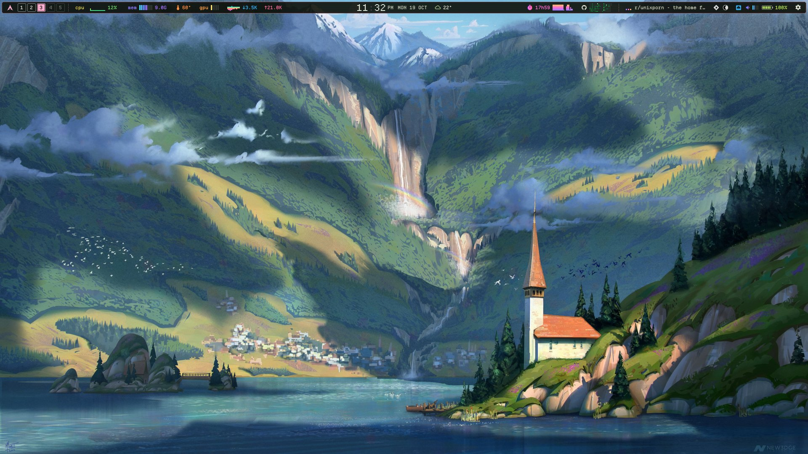

</div>

---

## Contents

- [Features](#features)
- [Screenshots](#screenshots)
- [Requirements](#requirements)
- [Install](#install)
- [Keybinds (niri)](#keybinds-niri)
- [IPC reference](#ipc-reference)
- [Configuration](#configuration)
- [Battery life](#battery-life)
- [Project layout](#project-layout)
- [Known limitations](#known-limitations)
- [Credits](#credits)

## Features

**Bar**: one full-width pixel strip per monitor.

- Arch button: click to open your launcher (vicinae by default), right-click for quick settings.
- Workspaces `1–5`, separate per monitor, filling up from the bottom like loading blocks. Scroll to switch. Clicking a workspace on another monitor doesn't warp the pointer.
- Live **CPU graph, memory meter, CPU temperature, iGPU load, network up/down graphs**. Click any of them for the full system panel.
- Rolling-reel **clock**, date and **weather** (wttr.in, with the city detected from your IP).
- **Screen time** with an hourly chart, and a **GitHub contribution heatmap**.
- Now playing (MPRIS) with a pixel equalizer, notifications, **system tray**, **pending updates**, network/volume/battery status.
- **Privacy indicators** while the mic, camera or screen sharing is in use (names the recording app).
- **Recording indicator** with a timer; click it to stop.

**Panels** drop out of the bar right under whatever you clicked, revealed downward in pixel steps:

| Panel | What's in it |
|---|---|
| system | big CPU graph, per-core meters, memory/swap, network, sensors, disks, top processes (hover to kill) |
| screen time | today vs yesterday, hour-by-hour chart, top apps, the past 7 days |
| github | full-year heatmap, streak, best streak, best day |
| control | volume / mic / brightness sliders, Wi-Fi, Bluetooth, DND and caffeine tiles, session buttons, notifications. **Right-click any control to jump to its settings page.** |
| media | album art rendered as chunky pixels, progress, controls |
| today | calendar + detailed weather |
| updates | pacman + AUR updates, one-click `paru -Syu` in kitty |

**Overlays**

- **Settings app**: a real window with a searchable sidebar and 12 pages: appearance, wallpaper, bar, clock & weather, notifications, network (scan, connect, forget), bluetooth (pair, connect, battery), sound (devices, per-app volume, live level meters), displays (layout map, mode, scale, rotation, VRR, brightness, "copy as KDL"), power (battery health, power profiles, power saver), data, about.
- **Session menu**: lock, screen off (monitors off without sleeping), sleep, log out, reboot, power off. Destructive actions need a second press.
- **Capture menu**: region / screen / window screenshots (saved + copied, optional swappy edit, delay) and region / screen recording via gpu-screen-recorder.
- **Clipboard history**: cliphist with search, keyboard navigation and image previews.
- **Volume / mic / brightness pop-ups** for the media keys.
- **Lock screen** (ext-session-lock + PAM): your wallpaper crushed to 160×90 and scaled up into pixel art.

**Theme**

- Chrome colors come from [matugen](https://github.com/InioX/matugen), generated from your wallpaper (or a custom accent), with 9 palette styles.
- Meters use neon btop-style gradients, or tones from the palette.
- Optional CRT scanlines and a passing scan beam.
- Global animation speed control.

## Screenshots

<table>
<tr>
<td>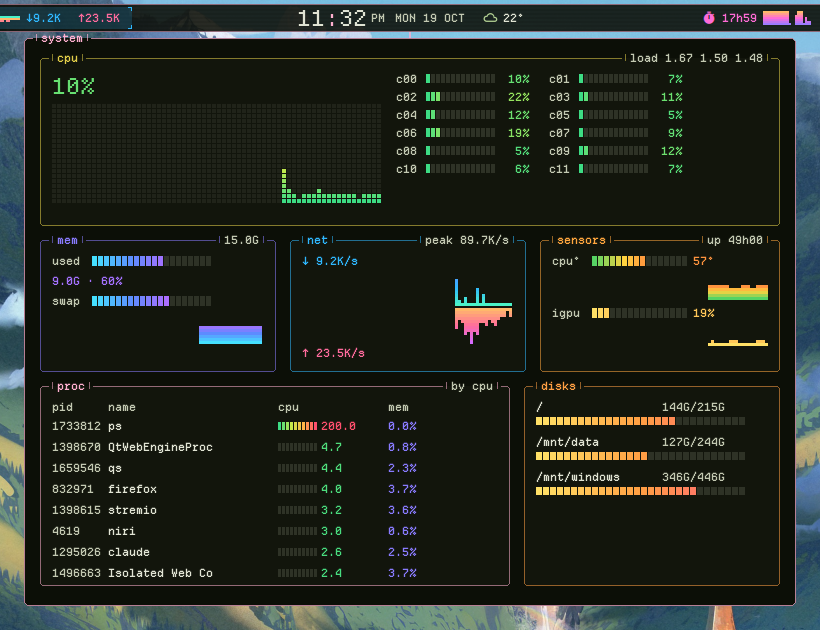</td>
<td>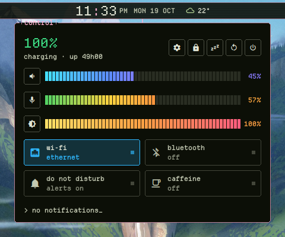<br>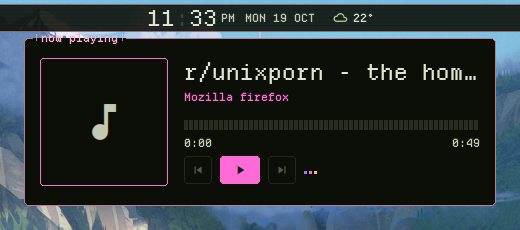</td>
</tr>
<tr>
<td>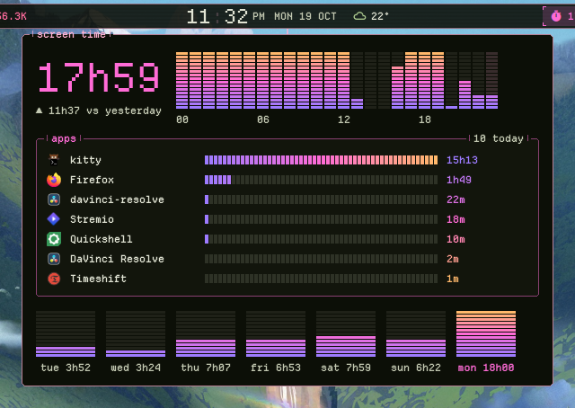</td>
<td>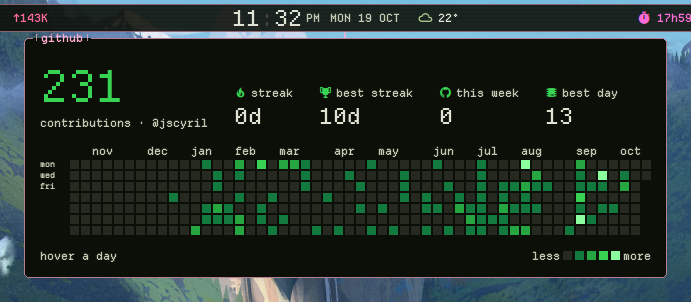<br>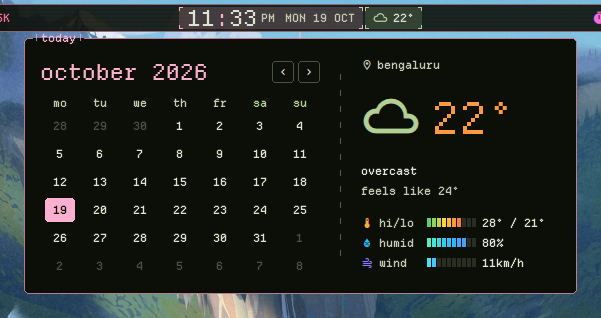</td>
</tr>
</table>

**The bar**

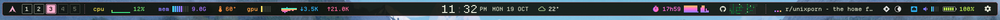

**Settings app**

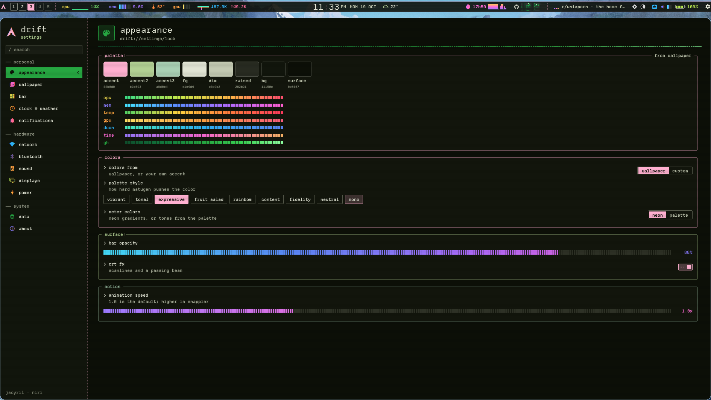

<table>
<tr>
<td>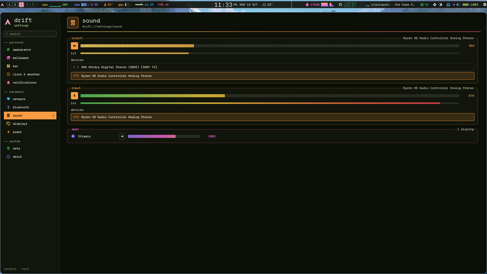</td>
<td>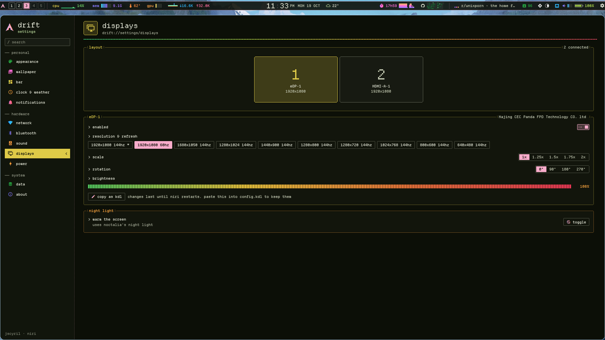</td>
</tr>
<tr>
<td>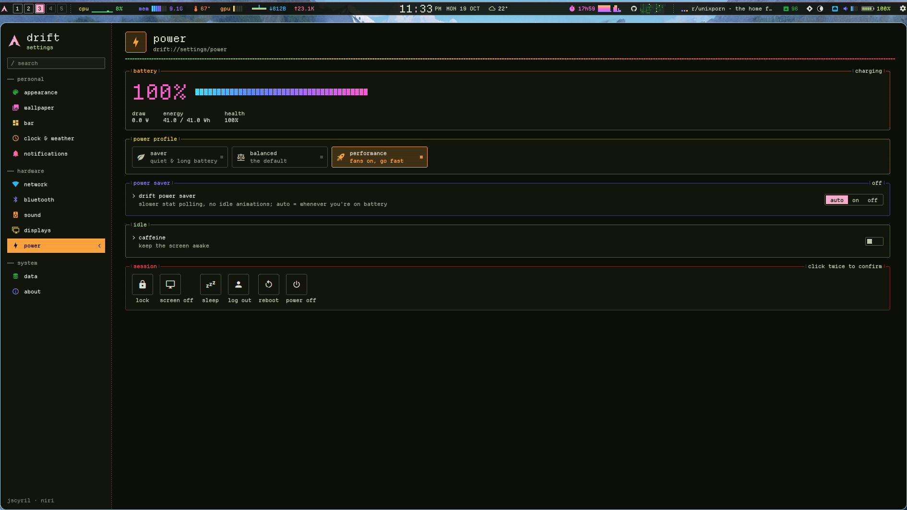</td>
<td>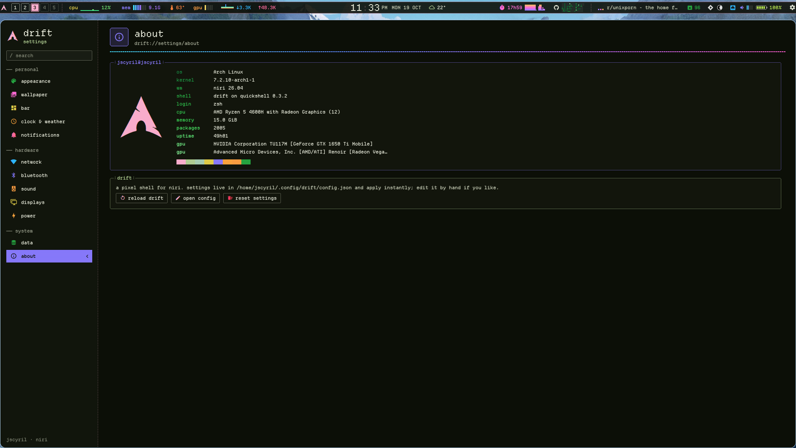</td>
</tr>
</table>

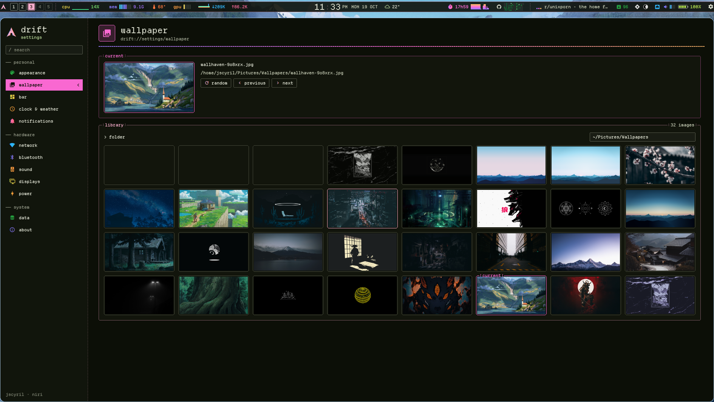

**Session menu, capture menu, pop-up and updates**

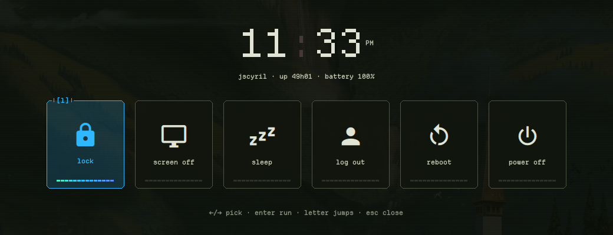

<table>
<tr>
<td>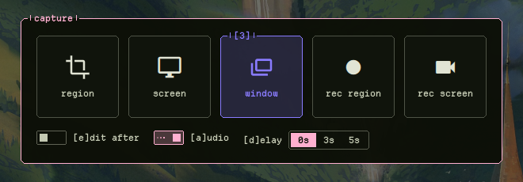<br>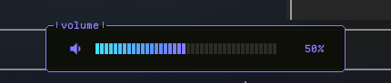</td>
<td>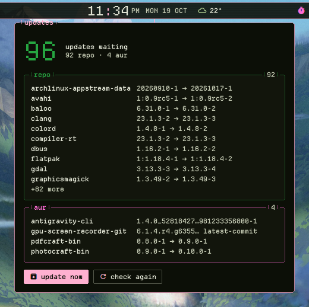</td>
</tr>
</table>

**Lock screen**

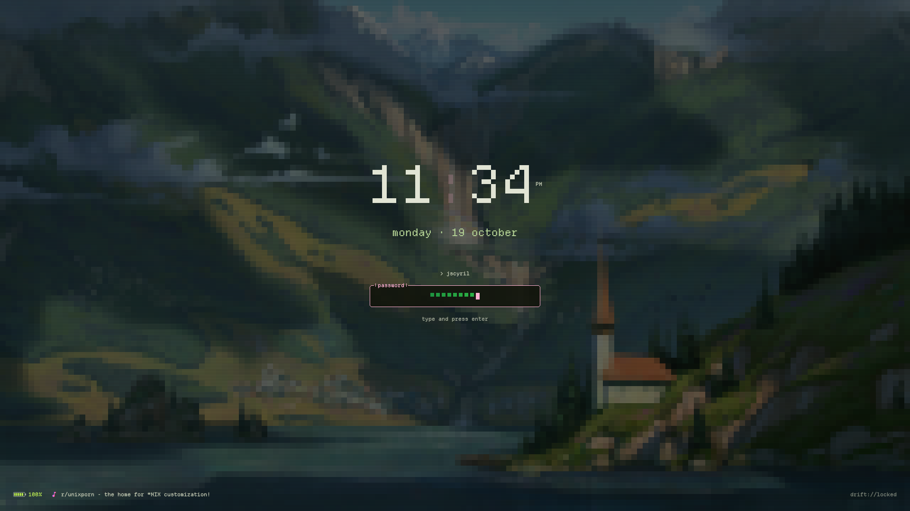

## Requirements

Built and tested on Arch Linux with niri 26.04 and Quickshell 0.3.2.

| Needed for | Packages (Arch) |
|---|---|
| core | `quickshell` `niri` `matugen` `jq` `socat` |
| fonts | [Departure Mono](https://departuremono.com) (pixel font), `ttf-material-design-icons-desktop-git` (AUR, icons) |
| audio / media | `pipewire` `wireplumber` (MPRIS players work out of the box) |
| network / bluetooth | `networkmanager` `bluez` |
| battery / power profiles | `upower` `power-profiles-daemon` or `tlp-pd` |
| brightness | `brightnessctl` |
| notifications | `libnotify` (drift *is* the daemon, so stop swaync/dunst/mako) |
| clipboard history | `cliphist` `wl-clipboard` |
| screenshots / recording | `grim` `slurp` `swappy` `gpu-screen-recorder` |
| updates | `pacman-contrib` (checkupdates), `paru` |
| camera indicator | `psmisc` (fuser) |
| terminal for updates | `kitty` |

Optional: `vicinae` as the launcher (any command works).

## Install

```sh
git clone https://github.com/jscyril/drift ~/.config/quickshell/drift
# install Departure Mono into ~/.local/share/fonts, then:
fc-cache -f
qs -c drift -d
```

Start it with niri by adding this to `~/.config/niri/config.kdl`:

```kdl
spawn-at-startup "qs" "-c" "drift" "-d"
spawn-at-startup "wl-paste" "--watch" "cliphist" "store"
```

Edits to any `.qml` file hot-reload instantly.

## Keybinds (niri)

```kdl
binds {
    Mod+Z         { spawn "qs" "-c" "drift" "ipc" "call" "drift" "session"; }
    Super+Alt+L   { spawn-sh "qs -c drift ipc call drift lock || loginctl lock-session"; }
    Mod+Alt+V     { spawn "qs" "-c" "drift" "ipc" "call" "drift" "clipboard"; }
    Print         { spawn "qs" "-c" "drift" "ipc" "call" "drift" "capture"; }
    Mod+Shift+X   { spawn "qs" "-c" "drift" "ipc" "call" "drift" "capture"; }

    XF86AudioRaiseVolume  allow-when-locked=true { spawn "qs" "-c" "drift" "ipc" "call" "drift" "volumeUp"; }
    XF86AudioLowerVolume  allow-when-locked=true { spawn "qs" "-c" "drift" "ipc" "call" "drift" "volumeDown"; }
    XF86AudioMute         allow-when-locked=true { spawn "qs" "-c" "drift" "ipc" "call" "drift" "volumeMute"; }
    XF86AudioMicMute      allow-when-locked=true { spawn "qs" "-c" "drift" "ipc" "call" "drift" "micMute"; }
    XF86MonBrightnessUp   allow-when-locked=true { spawn "qs" "-c" "drift" "ipc" "call" "drift" "brightnessUp"; }
    XF86MonBrightnessDown allow-when-locked=true { spawn "qs" "-c" "drift" "ipc" "call" "drift" "brightnessDown"; }
}
```

For hypridle, point `lock_cmd` / `before_sleep_cmd` at `qs -c drift ipc call drift lock`.

## IPC reference

Everything is reachable through `qs -c drift ipc call drift <function> [arg]`:

| Function | Does |
|---|---|
| `toggle <card>` | open/close a panel: `quick` `media` `today` `system` `screen` `github` `updates` (`settings` opens the app) |
| `settings <page>` | open the settings app on a page: `look` `wallpaper` `bar` `clock` `notifications` `network` `bluetooth` `sound` `displays` `power` `data` `about` |
| `session` | session menu |
| `capture` | capture menu |
| `clipboard` | clipboard history |
| `lock` | lock the session |
| `volumeUp` `volumeDown` `volumeMute` `micMute` `brightnessUp` `brightnessDown` | change the value and show the pop-up |
| `updatesRefresh` | re-check for updates |

## Configuration

All settings live in `~/.config/drift/config.json`. The settings app writes it, but you can also edit it by hand; both apply live. Notable keys:

| Key | Default | |
|---|---|---|
| `colorMode` | `"wallpaper"` | or `"custom"` with `customAccent` |
| `scheme` | `"scheme-vibrant"` | any matugen scheme type |
| `meterColors` | `"neon"` | or `"wallpaper"` |
| `barHeight` / `barMargin` | `28` / `4` | px |
| `workspaceCount` | `5` | cells per monitor |
| `show*` | `true` | toggle each bar module |
| `githubUser` | `""` | public profile for the heatmap |
| `weatherLocation` | `""` | empty = detect from IP |
| `idleMinutes` | `3` | screen time pauses after this |
| `launcherCommand` | `"vicinae toggle"` | what the Arch button runs |
| `wallpaperDir` | `"~/Pictures/Wallpapers"` | for the wallpaper picker |
| `powerSaver` | `"auto"` | `"auto"` (on battery), `"on"`, `"off"` |
| `animSpeed` | `1.0` | global animation speed |

Screen time is stored in `~/.local/state/drift/screentime.json` (90 days).

## Battery life

drift is built to be cheap to run:

- System stats are read straight from `/proc` and `/sys`, without spawning a process per sample.
- Nothing polls the NVIDIA dGPU, so it can stay asleep.
- **Power saver** turns on automatically on battery: stats every 5s instead of 1.5s, slower network and wallpaper checks, and no idle animations (scan beam, equalizer, colon blink, meter slides).

Measured on a Ryzen 5 4600H laptop: about **1% of one core** in power saver, versus about 7% with every effect running.

## Project layout

```
shell.qml           entry: bars per screen, overlays, IPC
Bar.qml             the bar + drop-down panels
SessionMenu.qml     CaptureMenu.qml  ClipboardMenu.qml  Osd.qml
Lock.qml            session lock + PAM;  LockContent.qml is what it draws
services/           singletons: Config, Theme, Niri, System, Stats, ScreenTime,
                    GitHub, Weather, Updates, Privacy, Capture
components/         pixel widgets: PixelBox, Meter, Graph, Heatmap, Switch, Slider, ...
cards/              the drop-down panels
settings/           the settings window and its pages
```

## Known limitations

- **Wallpaper and night light** currently go through Noctalia's `noctalia msg` (wallpaper get/set, night light). Without it, set `colorMode` to `custom`, or swap the commands in `services/Theme.qml` (wallpaper) and `settings/pages/Displays.qml` (night light) for your own tools.
- Display changes made in settings apply at runtime only. Use **copy as KDL** to keep them in niri's config.
- The temperature sensor is AMD `k10temp` and the GPU meter reads the AMD iGPU's `gpu_busy_percent`. Other hardware will show 0 until those paths are adjusted in `services/Stats.qml`.
- Updates use `paru`; swap in `yay` in `services/Updates.qml` if needed.

## Credits

- [Quickshell](https://quickshell.org): the toolkit drift is built on
- [niri](https://github.com/YaLTeR/niri): the compositor
- [matugen](https://github.com/InioX/matugen): wallpaper palettes
- [Departure Mono](https://departuremono.com): the pixel font
- [Material Design Icons](https://pictogrammers.com/library/mdi/): icons
- [btop](https://github.com/aristocratos/btop): the look that inspired it
